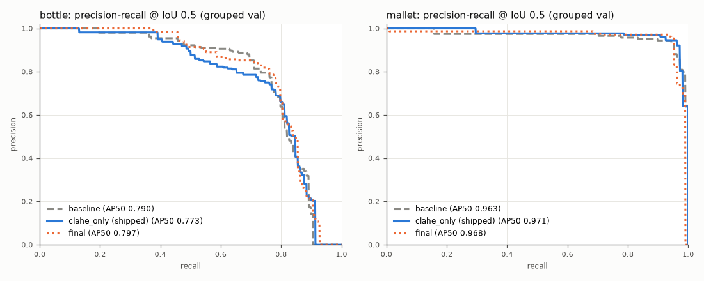
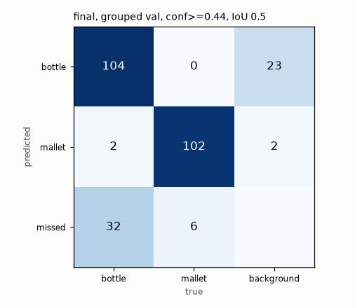

# Metrics

Generated by `scripts/evaluate.py`. All numbers below are from **CPU** validation, IoU 0.5 for P/R/F1/mAP50, NMS IoU 0.7, imgsz 512.

**Why these metrics.** A rover that must find the mallet cares about two different failures: missing it (recall) and chasing ghosts (precision). F1 at the deployed threshold summarises that trade-off at the operating point we actually ship; mAP50 summarises ranking quality across all thresholds; mAP50-95 adds localisation tightness (matters for grasping / approach). All are reported per class because a mean can hide one class failing.

P, R and F1 are each taken at that model's own confidence that maximises mean F1 on val.

## Ablation: per-class results on the grouped (leak-free) val split

| run | class | precision | recall | F1 | mAP50 | mAP50-95 | conf | best epoch / run |
|---|---|---|---|---|---|---|---|---|
| baseline | bottle | 0.772 | 0.762 | 0.767 | 0.790 | 0.459 | 0.389 | 58/60 |
| baseline | mallet | 0.944 | 0.929 | 0.936 | 0.963 | 0.623 | 0.389 | 58/60 |
| baseline | **mean** | 0.858 | 0.845 | 0.851 | 0.876 | 0.541 | 0.389 | 58/60 |
| final | bottle | 0.819 | 0.754 | 0.785 | 0.797 | 0.417 | 0.441 | 55/60 |
| final | mallet | 0.958 | 0.944 | 0.951 | 0.968 | 0.563 | 0.441 | 55/60 |
| final | **mean** | 0.889 | 0.849 | 0.868 | 0.883 | 0.490 | 0.441 | 55/60 |

Final minus baseline (mean over classes): F1 +0.017, mAP50 +0.006, mAP50-95 -0.051.

## Deployed threshold

`results/threshold.json`: **conf = 0.441** (max mean F1 on grouped val, final model). Caveat: it is chosen on the same val set the numbers are reported on (there is no separate test set in this 999-image sample), so P/R/F1 are slightly optimistic; mAP is threshold-free.

## Independent cross-check at the deployed threshold

Re-counted with `src/matching.py` (greedy, IoU >= 0.5) by running the *deployment* path (`src/infer.py`: raw JPEG -> `preprocess()` in memory -> YOLO) on the raw val images, not Ultralytics' validator on the pre-made PNGs. Agreement with the table above shows predict.py reproduces the reported metrics.

| run | class | GT | TP | FP | FN | precision | recall (±95% CI) | F1 |
|---|---|---|---|---|---|---|---|---|
| baseline | bottle | 138 | 105 | 31 | 33 | 0.772 | 0.761 ± 0.071 | 0.766 |
| baseline | mallet | 108 | 100 | 6 | 8 | 0.943 | 0.926 ± 0.049 | 0.935 |
| final | bottle | 138 | 104 | 23 | 34 | 0.819 | 0.754 ± 0.072 | 0.785 |
| final | mallet | 108 | 102 | 4 | 6 | 0.962 | 0.944 ± 0.043 | 0.953 |

Confusion matrix (final, rows = predicted, cols = true; 'missed' = GT with no prediction, 'background' = prediction on no object):

| predicted \ true | bottle | mallet | background |
|---|---|---|---|
| bottle | 104 | 0 | 23 |
| mallet | 2 | 102 | 2 |
| missed | 32 | 6 | – |

## Leakage inflation

Run (c) uses the final recipe on Roboflow's original split. Its val set is broken down by whether each image has a same-origin image in train (results/audit.md). Same model on both subsets; what differs is whether a near-duplicate of the image was in its training set.

| model / val subset | images | mean P | mean R | mean F1 | mAP50 | mAP50-95 | bottle mAP50 | mallet mAP50 |
|---|---|---|---|---|---|---|---|---|
| (c) leak model, all original val | 199 | 0.935 | 0.877 | 0.904 | 0.914 | 0.558 | 0.850 | 0.977 |
| (c) leak model, val images WITH train sibling | 107 | 0.938 | 0.910 | 0.923 | 0.930 | 0.568 | 0.871 | 0.989 |
| (c) leak model, val images WITHOUT sibling | 92 | 0.945 | 0.835 | 0.885 | 0.894 | 0.554 | 0.830 | 0.958 |
| (b) final model, grouped val | 199 | 0.889 | 0.849 | 0.868 | 0.883 | 0.490 | 0.797 | 0.968 |

- Reported-number inflation from using Roboflow's split: mAP50 +0.031 (original val vs grouped val, same recipe).
- Within the same model: leaked minus clean subset mAP50 = +0.036. Caveat: the subsets also differ in content (the leaked ones are mostly multi-shot outdoor sessions), so this gap is not *only* leakage.

## MPS vs CPU validation (final model, grouped val)

| device | mean P | mean R | mAP50 | mAP50-95 | bottle mAP50 | mallet mAP50 | conf@maxF1 |
|---|---|---|---|---|---|---|---|
| cpu | 0.8886 | 0.8490 | 0.8826 | 0.4902 | 0.7971 | 0.9681 | 0.441 |
| mps | 0.8886 | 0.8490 | 0.8826 | 0.4902 | 0.7971 | 0.9681 | 0.441 |

Max absolute difference in mean mAP50-95: 0.0000. CPU numbers are the ones reported everywhere else.

