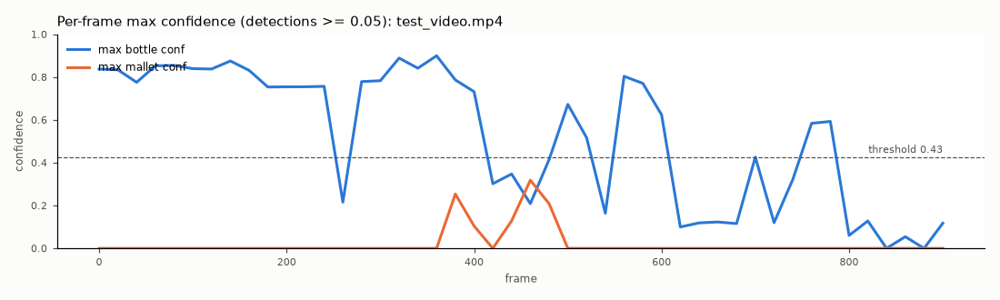

# Video test

- Source: `media/test_video.mp4`, 1080x1920, 60.0 fps, 906 frames; one frame in every 20 -> 46 frames analysed.
- Pipeline: identical to `predict.py` (stretch to 512x512 + CLAHE), conf >= 0.426, CPU.

| class | frames with >=1 detection | median max-conf when detected | presence flicker |
|---|---|---|---|
| bottle | 28/46 (61%) | 0.78 | 24% |
| mallet | 0/46 (0%) | 0.00 | 0% |

Presence flicker = share of consecutive analysed frames where the class appears/disappears.

Annotated frames (evenly spaced, 30 saved): `results/video/`.
